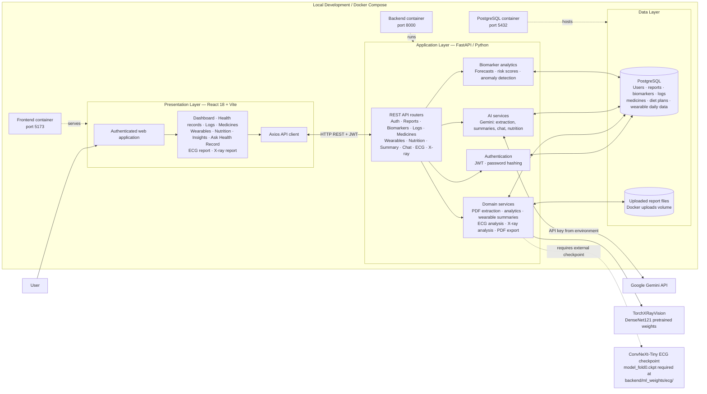

# Health Intelligence System — Project Architecture

## System block diagram

## Main data flows

1. **Sign in:** user signs in through the React app; FastAPI validates credentials and issues a JWT. Protected API requests include that token, and routes scope health records to the authenticated user.
2. **Lab report:** user uploads a PDF or image → FastAPI stores the file → PDFs are text-extracted → Gemini extracts biomarker values and dates → report and biomarker records are stored in PostgreSQL → dashboard and analytics endpoints return trends, forecasts, risk indicators, and anomalies.
3. **Health tracking:** logs, medicines, wearable records, and diet plans are read or written through authenticated API routes and persisted in PostgreSQL.
4. **AI assistance:** chat and summary routes gather the user’s health context and call Gemini to produce contextual responses or summaries.
5. **Medical image analysis:** X-ray analysis uses TorchXRayVision DenseNet121. ECG analysis uses a ConvNeXt-Tiny classifier and requires the separate `model_fold0.ckpt` checkpoint at `backend/ml_weights/ecg/`.

## Panel summary

> Health Intelligence is a containerized, three-tier web application. A React frontend communicates with a JWT-protected FastAPI backend. The backend manages user health records in PostgreSQL, processes uploaded reports, runs biomarker analytics, and calls Gemini for extraction and health explanations. Separate computer-vision services analyze X-ray and ECG images; ECG inference requires an externally supplied checkpoint file.

### Architecture at a glance

| Layer | Implementation | Responsibility |
|---|---|---|
| Presentation | React 18, Vite, React Router, Axios | Authenticated dashboards and health workflows |
| API / application | FastAPI, SQLAlchemy, JWT | API routing, authorization, orchestration, persistence |
| Analytics | Python / NumPy / scikit-learn | Biomarker forecasts, risk scoring, anomaly detection |
| AI | Google Gemini API | Report extraction, summaries, chat, nutrition plans |
| Medical imaging | TorchXRayVision DenseNet121; ConvNeXt-Tiny for ECG | Image-based analysis; ECG requires `model_fold0.ckpt` |
| Storage | PostgreSQL plus Docker uploads volume | Structured health data and uploaded report files |
| Runtime | Docker Compose | Runs frontend, backend, and database services |

### Security and scope notes

- The API uses JWT authentication and associates stored records with a user account.
- Gemini access is configured with an environment variable; its API call is outside the application containers.
- ECG weights are not bundled in the repository. The ECG analysis feature will return a missing-weights error until the checkpoint is supplied.
- Model outputs are informational and should be reviewed by a qualified healthcare professional; they are not diagnoses.
